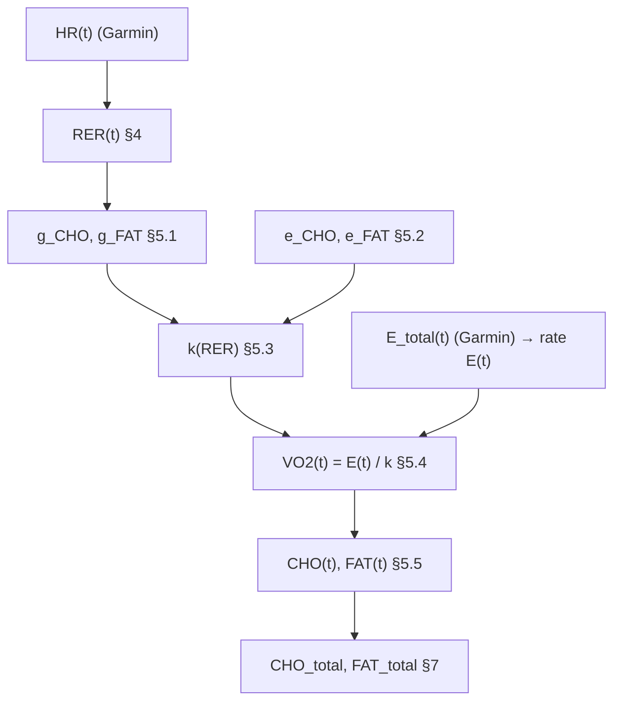

# Estimating carbohydrate and fat oxidation from heart rate and Garmin's energy estimate

This is the theoretical basis of the model used from **version 1.0** on. It estimates
the oxidation rate of carbohydrate (CHO) and fat (FAT) during exercise from the
**energy that Garmin estimates** for the activity, and splits it between the two fuels
with a respiratory exchange ratio (RER) estimated from heart rate (HR).

> **Papers (PDF).** This page is the web version of the paper
> [English](paper/model-fc-energia.en.pdf) · [Català](paper/model-fc-energia.ca.pdf)
> (DOI: [10.5281/zenodo.24424749](https://doi.org/10.5281/zenodo.24424749)).
> The previous model, which also estimated the energy from HR alone, is described in
> [Theoretical basis (HR model)](01-theoretical-basis.md).

## 1. Aim

We want to estimate, at each instant $t$ of the activity, the **oxidation rate** of
carbohydrate and fat:

$$CHO(t),\ FAT(t) \quad \text{[g/min]}$$

and, from these rates, the **cumulative total** for the whole activity, from $0$ to the
total duration $T$:

$$CHO_{total}(T) = \int_0^T CHO(t)\,dt \qquad\qquad FAT_{total}(T) = \int_0^T FAT(t)\,dt$$

The integral is the cumulative total: everything oxidised from the start up to $T$
(§7 explains how it is computed with Garmin data). If desired, this information can
help decide how much carbohydrate to take in during exercise (Jeukendrup, 2014).

### 1.1. The approach

Indirect calorimetry computes these rates from respiratory gases (§3), but it needs a
gas analyser. Here we estimate them with Garmin devices (watches and Edge bike
computers), which measure HR and estimate the energy expended. The steps are:

1. From Garmin we obtain the energy expended, $E(t)$ (§2.4).
2. The $RER$ is estimated from HR (§4).
3. From the $RER$ and $E(t)$ we can estimate $VO_2$ (§5).
4. With $VO_2$ and the $RER$, the equations of Jeukendrup and Wallis give $CHO(t)$ and
   $FAT(t)$ (§3).

### 1.2. Why this approach

Another option is to estimate oxygen uptake from HR, with a fixed relationship between
the two (Swain & Leutholtz, 1997; [HR model](01-theoretical-basis.md)). But then the
energy that comes out of the computed grams does not match the energy shown by Garmin:
it tends to be higher. Garmin uses more information: besides HR, the user profile and
each person's relationship between HR and oxygen uptake (Firstbeat, 2007).

That is why this model starts from a **condition**: the energy of the computed grams
must be exactly the energy given by Garmin. Half-jokingly, we call it the **"Garmin
energy conservation principle"**, by analogy with the law of physics: here the energy
is set not by nature, but by Garmin. The method does not recompute the energy; it only
splits it between the two fuels. This condition is what determines everything (§5).

*Outline of the method. HR gives the RER, and the RER the grams oxidised per litre of
oxygen. With the energy per gram of each substrate we get the energy per litre of
oxygen, $k$, which converts Garmin's energy rate into oxygen uptake. With oxygen uptake
and the RER we get the oxidation rates, and from there the totals.*

## 2. Background

### 2.1. Oxygen uptake ($VO_2$) and CO2 output ($VCO_2$)

$VO_2(t)$ is the volume of oxygen the body takes up per unit of time, in L/min.
$VCO_2(t)$ is the volume of carbon dioxide produced. Both are the basis of **indirect
calorimetry**: oxidising fat or carbohydrate uses O2 and produces CO2 in different
proportions, so by measuring $VO_2$ and $VCO_2$ we can tell which fuel is being burned.

### 2.2. Maximal oxygen uptake ($VO_{2max}$)

The highest $VO_2$ a person can reach. Here it is only used to express intensities and
to detect impossible values of $VO_2(t)$.

### 2.3. Respiratory exchange ratio ($RER$)

$$RER(t) = \frac{VCO_2(t)}{VO_2(t)}$$

A single number that shows the fuel mix. Oxidising glucose produces as much CO2 as the
O2 it uses ($RER = 1$); oxidising fat produces less ($RER \approx 0.70$). It is the key
variable for the split between carbohydrate and fat.

### 2.4. Energy estimated by Garmin devices

Garmin devices compute the energy of the activity with a method by Firstbeat, a
Finnish company specialised in physiological analysis based on heart rate; its consumer
division (Firstbeat Analytics) has been part of Garmin since 2020. The method uses HR
and the user profile, and takes into account each person's relationship between HR and
oxygen uptake. We call $E(t)$ the **rate** of energy expenditure (kcal/min) and
$E_{total}(t)$ the **cumulative** energy since the start (kcal):

$$E_{total}(t) = \int_0^t E(s)\,ds$$

Garmin gives $E_{total}(t)$; the rate $E(t)$ is obtained from the increments of this
counter (§7). It is the **total** energy: it also includes the resting metabolism
during that time (Garmin Connect splits it into resting and active calories). This is
the energy we need, because the calorimetry equations count all the oxidation from all
the oxygen used. It is an estimate, not a measurement: studies on wearable devices find
larger errors in it than in the measurement of HR (Shcherbina et al., 2017; Fuller et
al., 2020).

### 2.5. Notation

| Symbol | Meaning | Units |
|---|---|---|
| $CHO(t)$, $FAT(t)$ | Carbohydrate and fat oxidation rate (the result) | g/min |
| $CHO_{total}(T)$, $FAT_{total}(T)$ | Total oxidised from the start up to $T$ | g |
| $VO_2(t)$, $VCO_2(t)$ | O2 uptake and CO2 output | L/min |
| $RER(t)$ | Respiratory exchange ratio, $VCO_2/VO_2$ | — |
| $E_{total}(t)$ | Cumulative energy since the start (given by Garmin) | kcal |
| $E(t)$ | Rate of energy expenditure (obtained from $E_{total}$) | kcal/min |
| $g_{CHO}(RER)$, $g_{FAT}(RER)$ | Grams of substrate oxidised per litre of O2 | g/L |
| $e_{CHO}$, $e_{FAT}$ | Energy per gram of oxidised substrate; constants 4.1 and 9.3 | kcal/g |
| $k(RER)$ | Energy released per litre of O2 | kcal/L |
| $HR(t)$, $LT_1$, $LT_2$, $HR_{max}$, $I_{onset}$ | Heart rate and RER reference points | bpm |

## 3. The starting point: the equations of Jeukendrup and Wallis

The relationship between the oxygen used, the CO2 produced and the grams of substrate
oxidised is known from the classical indirect calorimetry equations of Frayn (1983).
They are "non-protein" equations: they assume all the energy comes from carbohydrate
and fat, and they ignore protein oxidation, which provides little energy during
exercise. We use the exercise version by Jeukendrup and Wallis (2005):

$$CHO(t) = 4.210 \cdot VCO_2(t) - 2.962 \cdot VO_2(t)$$

$$FAT(t) = 1.695 \cdot VO_2(t) - 1.701 \cdot VCO_2(t)$$

with gases in L/min and the result in g/min. Neither $VO_2$ nor $VCO_2$ can be
measured without a gas analyser, so they have to be estimated.

### 3.1. Rewriting the equations with the RER

Instead of estimating $VO_2$ and $VCO_2$ separately, it is more practical to estimate
$VO_2$ and the $RER$. Substituting $VCO_2(t) = RER(t)\cdot VO_2(t)$:

$$CHO(t) = VO_2(t)\cdot\bigl(4.210 \cdot RER(t) - 2.962\bigr)$$

$$FAT(t) = VO_2(t)\cdot\bigl(1.695 - 1.701 \cdot RER(t)\bigr)$$

**The extremes.** Outside the range 0.704–0.9965 one of the two brackets becomes
negative; that is why it is set to zero ($CHO = 0$ below, $FAT = 0$ above).

Two estimates are now needed: $RER(t)$ (§4) and $VO_2(t)$ (§5). The RER comes first,
because it is needed to estimate $VO_2$.

## 4. Estimating $RER(t)$: metabolic thresholds

The RER rises with intensity, especially around the metabolic thresholds: the first
($LT_1$, aerobic threshold) and the second ($LT_2$, lactate or anaerobic threshold). It
is estimated from HR exactly as in the [HR model](01-theoretical-basis.md) (§5–6 there),
where the full justification is given. Here we only give the result.

### 4.1. Interpolation model

Four HR points are fixed ($I_{onset}$, $LT_1$, $LT_2$ and $HR_{max}$), each with an RER
value. Between two consecutive points we interpolate linearly. With 4 reference points
we obtain a piecewise function with 5 parts: constant up to $I_{onset}$, three straight
segments between points, and constant from $HR_{max}$ on:

$$
RER(t)=
\begin{cases}
R_{basal} & HR(t)\le I_{onset}\\[4pt]
R_{basal}+\dfrac{HR(t)-I_{onset}}{LT_1-I_{onset}}\bigl(R_{LT_1}-R_{basal}\bigr) & I_{onset}<HR(t)\le LT_1\\[10pt]
R_{LT_1}+\dfrac{HR(t)-LT_1}{LT_2-LT_1}\bigl(R_{LT_2}-R_{LT_1}\bigr) & LT_1<HR(t)\le LT_2\\[10pt]
R_{LT_2}+\dfrac{HR(t)-LT_2}{HR_{max}-LT_2}\bigl(R_{max}-R_{LT_2}\bigr) & LT_2<HR(t)\le HR_{max}\\[6pt]
R_{max} & HR(t)>HR_{max}
\end{cases}
$$

| HR point | Name | RER |
|---|---|---|
| Up to $I_{onset}$ (easy effort) | $R_{basal}$ | 0.86 |
| $LT_1$ | $R_{LT_1}$ | 0.91 |
| $LT_2$ | $R_{LT_2}$ | 0.98 |
| $HR_{max}$ and above | $R_{max}$ | 1.00 |

Above $LT_2$ the measured RER can exceed 1, but this excess is not carbohydrate
oxidation. That is why the ceiling is 1.00, where fat is zero (§3.1).

### 4.2. Parameters

If the athlete has had a lactate test or an exercise test with gas analysis, their real
values are used. If not, they are estimated as in the HR model:
$LT_1 \approx 0.89 \cdot LT_2$ and $I_{onset} \approx 0.70 \cdot LT_2$.

Body mass and $VO_{2max}$ are not needed to compute the grams: they are already included
in the energy computed by Garmin. But this energy depends on the user profile on the
device (body mass, age, maximum HR, $VO_{2max}$), so it must be kept up to date.

The RER has little weight in oxygen uptake and a large weight in the split between
carbohydrate and fat (§6). That is why **what matters most is that the thresholds,
especially $LT_2$, are set correctly**.

## 5. Estimating $VO_2(t)$ from Garmin's energy

**What we have.** The rate of energy expenditure $E(t)$, obtained from Garmin's
cumulative energy $E_{total}(t)$, and $RER(t)$, estimated from HR.

**What we want.** The oxygen uptake $VO_2(t)$, with the condition of §1.2: the energy of
the resulting grams must be exactly $E(t)$.

**How we do it.** If we multiply the kcal released by each litre of oxygen at instant
$t$, $k\bigl(RER(t)\bigr)$ (it depends on the fuel mix at that moment), by the litres of
oxygen taken up per minute, $VO_2(t)$, we obtain the rate of energy expenditure:

$$E(t) = k\bigl(RER(t)\bigr)\cdot VO_2(t)$$

We can obtain $E(t)$ from what Garmin gives. So, if we estimate $k$ (the energy per
litre), we only need to solve for oxygen uptake:

$$VO_2(t) = \frac{E(t)}{k\bigl(RER(t)\bigr)}$$

$k$ is the key piece. It is built in three steps: the grams burned by each litre of
oxygen (§5.1), the energy of each gram (§5.2) and, by multiplying, the energy of each
litre (§5.3).

### 5.1. Grams of each substrate per litre of oxygen

Dividing both sides of the equations of §3.1 by $VO_2(t)$, on the left we get grams per
minute divided by litres per minute, that is, **grams per litre**:

$$g_{CHO}(RER) = 4.210 \cdot RER - 2.962 \qquad g_{FAT}(RER) = 1.695 - 1.701 \cdot RER \qquad \text{[g/L]}$$

They depend only on the RER. For example, with $RER = 0.86$ each litre of oxygen burns
0.66 g of carbohydrate and 0.23 g of fat. At the extremes they are set to zero (§3.1).

### 5.2. Energy per gram of each substrate

Fully oxidising one gram of substrate releases a fixed amount of energy (its **energy
density**). The method uses two constants:

$$e_{CHO} = 4.1 \text{ kcal/g} \qquad e_{FAT} = 9.3 \text{ kcal/g}$$

| Source | Carbohydrate (kcal/g) | Fat (kcal/g) |
|---|---|---|
| Atwater factors (foods) | 4 | 9 |
| Oxidised glucose / glycogen (Livesey & Elia, 1988) | ≈ 3.7 / ≈ 4.2 | — |
| Oxidised triacylglycerols (Livesey & Elia, 1988) | — | ≈ 9.4 |
| **This model** ($e_{CHO}$, $e_{FAT}$) | **4.1** | **9.3** |

During exercise, the carbohydrate oxidised is mainly glycogen and the fat,
triacylglycerols. The chosen values are close to both, which are precisely the
substrates the equations of Jeukendrup and Wallis are designed for. Two checks support
them (§5.3).

### 5.3. Energy per litre of oxygen, $k(RER)$

Each litre of oxygen oxidises $g_{CHO}$ grams of carbohydrate and $g_{FAT}$ grams of
fat, and each gram releases $e_{CHO}$ or $e_{FAT}$ kcal. Therefore each litre releases

$$k(RER) = e_{CHO}\cdot g_{CHO}(RER) + e_{FAT}\cdot g_{FAT}(RER) \qquad \text{[kcal/L]}$$

Between $RER \approx 0.704$ and $0.9965$, substituting and grouping terms:

$$
\begin{aligned}
k(RER) &= 4.1\cdot(4.210\cdot RER-2.962)+9.3\cdot(1.695-1.701\cdot RER)\\
       &= 3.620+1.442\cdot RER
\end{aligned}
$$

$k$ varies little: from 4.63 kcal/L ($RER = 0.704$) to 5.06 kcal/L ($RER = 0.9965$).
So energy and oxygen are almost proportional. Varying little does not mean it is
constant: it is computed with the RER of each instant.

!!! success "Justification of $e_{CHO}$ and $e_{FAT}$ — (a) Classical calorimetry"
    **What is checked:** that $e_{CHO}$ and $e_{FAT}$ give the same energy per litre of
    oxygen as classical calorimetry when only one substrate is burned.

    According to the table of Péronnet and Massicotte (1991), one litre of O2 releases
    5.047 kcal when only carbohydrate is burned and 4.686 kcal when only fat is burned.
    At these extremes each litre burns $g_{CHO}(1.00) = 1.248$ g of carbohydrate or
    $g_{FAT}(0.70) = 0.504$ g of fat:

    $$\frac{5.047}{1.248}\approx 4.05 \text{ kcal/g} \qquad \frac{4.686}{0.504}\approx 9.30 \text{ kcal/g}$$

    **Result:** these are the values of §5.2.

!!! success "Justification of $e_{CHO}$ and $e_{FAT}$ — (b) Weir's formula"
    **What is checked:** that $k(RER)$ matches the classical formula of Weir (1949).
    This formula is not used in the method: it only serves to check $k$.

    Weir relates gases and energy (without the urinary nitrogen term):
    $E(t) = 3.941\cdot VO_2(t) + 1.106\cdot VCO_2(t)$. Substituting
    $VCO_2 = RER\cdot VO_2$ and dividing by $VO_2$, the energy per litre is

    $$\frac{E(t)}{VO_2(t)} = 3.941 + 1.106\cdot RER(t) \qquad \text{[kcal/L]}$$

    Compared with ours, $k(RER) = 3.620 + 1.442\cdot RER$, they are two very close
    straight lines:

    | RER | $k$ | Weir | difference |
    |---|---|---|---|
    | 0.70 | 4.690 | 4.715 | −0.5 % |
    | 0.80 | 4.773 | 4.826 | −1.1 % |
    | 0.86 | 4.859 | 4.892 | −0.7 % |
    | 0.91 | 4.931 | 4.947 | −0.3 % |
    | 0.95 | 4.989 | 4.992 | −0.1 % |
    | 0.98 | 5.032 | 5.025 | +0.1 % |
    | 1.00 | 5.117 | 5.047 | +1.4 % |

    **Result:** the difference is below 1.5 % over the whole range. The small jump
    between $RER = 0.9965$ and $1.00$ is because fat is already zero there and $k$ is
    no longer the straight line: only $e_{CHO}\cdot g_{CHO}$ remains.

### 5.4. Oxygen uptake from energy

$$VO_2(t) = \frac{E(t)}{k\bigl(RER(t)\bigr)} \qquad \left[\frac{\text{kcal/min}}{\text{kcal/L}} = \frac{\text{L}}{\text{min}}\right]$$

For example, if 12 kcal/min are expended and each litre releases 4.94 kcal, the oxygen
uptake is $12/4.94 = 2.43$ L/min. This value can be compared with $VO_{2max}$ to detect
impossible values.

### 5.5. Oxidation rate of each substrate

Inserting $VO_2(t) = E(t)/k\bigl(RER(t)\bigr)$ into the equations of §3.1, and using the
simple form of $k$, we get formulas that depend only on the energy and the RER:

$$CHO(t) = E(t)\cdot\frac{4.210\cdot RER(t)-2.962}{3.620+1.442\cdot RER(t)}$$

$$FAT(t) = E(t)\cdot\frac{1.695-1.701\cdot RER(t)}{3.620+1.442\cdot RER(t)}$$

They hold between $RER \approx 0.704$ and $0.9965$; outside this range the extremes are
set to zero and the general form of $k$ is used. **The amount of energy comes from
Garmin, and the RER determines how it is split.**

!!! success "“Garmin energy conservation principle”"
    **What is checked:** that the condition on which the method is built holds: the
    energy of the computed grams is exactly the energy given by Garmin.

    Multiplying each rate by its energy per gram and adding:

    $$
    \begin{aligned}
    e_{CHO}\cdot CHO(t)+e_{FAT}\cdot FAT(t)
    &= VO_2(t)\cdot\Bigl(e_{CHO}\cdot g_{CHO}\bigl(RER(t)\bigr)+e_{FAT}\cdot g_{FAT}\bigl(RER(t)\bigr)\Bigr)\\
    &= \frac{E(t)}{k\bigl(RER(t)\bigr)}\cdot k\bigl(RER(t)\bigr) = E(t)
    \end{aligned}
    $$

    **Result:** it holds exactly, whatever the RER, also at the extremes.

    This happens because $k$ is computed with the same numbers as the equations of
    Jeukendrup and Wallis. It does not justify the values 4.1 and 9.3 (it would hold
    with any pair, if $k$ used the same ones), but it guarantees that the amount of
    energy is always Garmin's, and that the method only splits it. With a fixed $k$ or
    with Weir's, oxygen uptake would be practically the same, but the energy of the
    grams would not match Garmin's (differences of up to 4 % and 1.5 %).

## 6. Error as a function of the RER

The RER is estimated from HR, and each person's real value can be somewhat different
(§9). How do the computed grams change when the RER varies by an amount $\varepsilon$,
with the energy $E$ fixed? The formulas of §5.5 have the form

$$CHO(RER) = E\cdot\frac{a\cdot RER-b}{k(RER)} \qquad FAT(RER) = E\cdot\frac{a'-b'\cdot RER}{k(RER)} \qquad k(RER) = c+d\cdot RER$$

with $a = 4.210$, $b = 2.962$, $a' = 1.695$, $b' = 1.701$, $c = 3.620$ and $d = 1.442$.

**Exact variation.** If the RER goes from $RER$ to $RER+\varepsilon$:

$$
\begin{aligned}
\Delta CHO &= E\cdot\left(\frac{a\,(RER+\varepsilon)-b}{k(RER+\varepsilon)}-\frac{a\cdot RER-b}{k(RER)}\right)\\[4pt]
&= \frac{(a\,c+b\,d)\cdot E\cdot\varepsilon}{k(RER)\cdot k(RER+\varepsilon)}
 = \frac{19.51\cdot E\cdot\varepsilon}{k(RER)\cdot k(RER+\varepsilon)}
\end{aligned}
$$

$$\Delta FAT = -\frac{(b'c+a'd)\cdot E\cdot\varepsilon}{k(RER)\cdot k(RER+\varepsilon)} = -\frac{8.60\cdot E\cdot\varepsilon}{k(RER)\cdot k(RER+\varepsilon)}$$

In the numerator the terms with RER cancel out. The variation is proportional to
$\varepsilon$ and to $E$, and the RER only appears through $k$, which varies little. The
total energy does not change: $4.1\cdot 19.51 \approx 9.3\cdot 8.60 \approx 80$, so the
energy gained by carbohydrate is the energy lost by fat.

**Approximation.** For small variations, $k(RER+\varepsilon)\approx k(RER)$ (error below
1.5 % even with $\varepsilon = 0.05$):

$$\Delta CHO \approx \frac{19.51}{k(RER)^2}\cdot E\cdot\varepsilon \qquad \Delta FAT \approx -\frac{8.60}{k(RER)^2}\cdot E\cdot\varepsilon$$

**Bounds.** Within the valid RER range, $k$ goes from 4.63 to 5.06:

| RER | $k$ (kcal/L) | $k^2$ | $19.51/k^2$ | $8.60/k^2$ |
|---|---|---|---|---|
| 0.704 | 4.63 | 21.5 | 0.91 | 0.40 |
| 0.85 | 4.85 | 23.5 | 0.83 | 0.37 |
| 0.9965 | 5.06 | 25.6 | 0.76 | 0.34 |

The carbohydrate factor always lies between 0.76 and 0.91. Taking the middle value,
0.83, the error is at most ±9 %. With $E$ in kcal/min, and multiplying by 60 to get g/h:

$$\Delta CHO \approx 0.83\cdot E\cdot\varepsilon \text{ [g/min]} \approx 50\cdot E\cdot\varepsilon \text{ [g/h]} \qquad \Delta FAT \approx -22\cdot E\cdot\varepsilon \text{ [g/h]}$$

**Example.** With $E = 12$ kcal/min and $\varepsilon = 0.01$: $\Delta CHO \approx 6$ g/h
and $\Delta FAT \approx -2.6$ g/h (the exact formula gives 5.9 g/h at $RER = 0.86$ and
5.6 g/h at $RER = 0.95$). If a person's real RER differs by 0.04 from the estimate, the
difference is about 24 g/h of carbohydrate.

!!! note "Conclusion"
    - The variation of the grams is proportional to the variation of the RER and to the
      energy, and it hardly depends on the value of the RER.
    - **Rule of thumb: $\Delta CHO \approx 50\cdot E\cdot\varepsilon$ g/h and
      $\Delta FAT \approx -22\cdot E\cdot\varepsilon$ g/h** ($E$ in kcal/min). At
      12 kcal/min, each 0.01 of RER is about 6 g/h of carbohydrate, and about 2.6 g/h of
      fat in the opposite direction.
    - The total energy does not change: the RER only determines how it is split.
    - That is why what matters most is to have the thresholds, especially $LT_2$, set
      correctly.

## 7. Computing $CHO_{total}$ and $FAT_{total}$

### 7.1. Garmin gives the cumulative energy

Garmin does not give the rate $E(t)$, but the cumulative energy $E_{total}(t)$, as an
integer number of kilocalories that goes up one by one (Connect IQ API,
`Activity.Info.calories`). In real activities with a Garmin watch it has been checked
that:

- the counter is the **total** energy (resting included): its final value matches the
  activity total;
- it goes up by 1 kcal each time, at intervals that depend on intensity (every 5–7 s
  when running);
- it does not advance while the timer is stopped.

It can be read, together with HR, about once per second.

### 7.2. Intervals between increments

Each time the counter goes up, it closes an interval $j$, between instants $t_{j-1}$ and
$t_j$, with an energy

$$\Delta E_j = E_{total}(t_j) - E_{total}(t_{j-1}) = \int_{t_{j-1}}^{t_j} E(t)\,dt$$

It is the integral of the energy over that interval, and we do not have to compute it:
the Garmin counter gives it. It is normally 1 kcal.

**The grams of each interval** are the integral of the rate over that interval:

$$\Delta CHO_j = \int_{t_{j-1}}^{t_j} CHO(t)\,dt = \int_{t_{j-1}}^{t_j} E(t)\cdot\frac{g_{CHO}\bigl(RER(t)\bigr)}{k\bigl(RER(t)\bigr)}\,dt$$

The interval lasts about 5 s, and we take the RER as constant over it, equal to the
time-weighted mean of the per-second values:

$$\overline{RER}_j = \frac{\sum_i RER_i\cdot\Delta t_i}{\sum_i \Delta t_i}$$

Then $g_{CHO}/k$ is a fixed number and comes out of the integral. What remains is the
integral of the energy, which is $\Delta E_j$:

$$\Delta CHO_j \approx \Delta E_j\cdot\frac{g_{CHO}(\overline{RER}_j)}{k(\overline{RER}_j)} \qquad \Delta FAT_j \approx \Delta E_j\cdot\frac{g_{FAT}(\overline{RER}_j)}{k(\overline{RER}_j)}$$

The only approximation is taking the RER as constant for a few seconds; since the
intervals are so short, it hardly changes the result. The first reading falls at any
point between two increments, so the first interval is partial.

### 7.3. Totals

The totals are the integral over the whole activity, which is the sum of the integrals
over each interval:

$$CHO_{total}(T) = \int_0^T CHO(t)\,dt = \sum_j \int_{t_{j-1}}^{t_j} CHO(t)\,dt = \sum_j \Delta CHO_j$$

and likewise for fat. **Garmin does the integral of the energy for us; we only need to
add up the pieces.** By the "Garmin energy conservation principle", applied to each
interval,

$$e_{CHO}\cdot CHO_{total}(T) + e_{FAT}\cdot FAT_{total}(T) = E_{total}(T) - E_{total}(t_0)$$

the energy that is split is exactly the energy Garmin has counted since the first
reading $t_0$, with no summation error. If the counter is not read for a while, no
energy is lost: the next increment already includes it. Nothing accumulates while the
timer is stopped.

## 8. Example

An athlete with $LT_2 = 166$ bpm and $HR_{max} = 180$ bpm runs at 150 bpm, and from the
Garmin counter the expenditure rate is $E = 12$ kcal/min.

1. **RER**: $LT_1 = 0.89\cdot 166 = 147.7$ bpm, so
   $RER = 0.91 + \frac{150-147.7}{166-147.7}\cdot(0.98-0.91) = 0.919$.
2. **Grams per litre**: $g_{CHO} = 4.210\cdot 0.919 - 2.962 = 0.906$ g/L and
   $g_{FAT} = 1.695 - 1.701\cdot 0.919 = 0.132$ g/L.
3. **Energy per gram**: $e_{CHO} = 4.1$ and $e_{FAT} = 9.3$ kcal/g.
4. **Energy per litre**: $k = 4.1\cdot 0.906 + 9.3\cdot 0.132 = 4.944$ kcal/L.
5. **Oxygen uptake**: $VO_2 = 12/4.944 = 2.43$ L/min.
6. **Oxidation rate**: $CHO = 2.43\cdot 0.906 = 2.20$ g/min and
   $FAT = 2.43\cdot 0.132 = 0.32$ g/min, that is, **132 g/h of carbohydrate and 19 g/h
   of fat**.

Starting condition: $4.1\cdot 2.198 + 9.3\cdot 0.321 = 12.00$ kcal/min.

## 9. Sources of error and limitations

| Source | Description | Affects |
|---|---|---|
| Garmin's energy | Manufacturer's computation, with known errors in wearable devices (Shcherbina et al., 2017; Fuller et al., 2020); depends on the user profile (body mass, age, maximum HR, $VO_{2max}$) | Amount (and grams, in the same proportion) |
| Estimated RER | Typical population values; each person can differ by about ±0.04 (Goedecke et al., 2000); depends on the thresholds, especially $LT_2$ | Split |
| Exercise duration | The real RER decreases as exercise goes on (Rothschild et al., 2022); the model does not account for it | Split (CHO overestimated from the second hour on) |
| Diet, fasting, fitness | Fasting or a low-carbohydrate diet lower the RER; see the [HR model](01-theoretical-basis.md) §10 | Split |
| Protein | The equations ignore protein oxidation: its energy, which is small, is assigned to carbohydrate and fat | Split (small) |
| Anaerobic glycolysis | Above $LT_2$ glycogen is used that does not appear in the oxidation computed from gases | Split (CHO underestimated) |

The split cannot be adjusted with any Garmin data, because Garmin says nothing about
carbohydrate and fat. Validating it requires an exercise test with a gas analyser. The
energy, on the other hand, is as good as Garmin's estimate: if that improves, the
result improves without changing anything.

## 10. Real-time estimate of mean CHO use

**What we want.** A real-time estimate of how many grams of carbohydrate per hour are
being oxidised, giving more weight to the last minutes.

**The problem.** The grams arrive in jumps. At each 1 kcal increment (every 5 s or so)
the grams of the interval come in all at once, and between increments none come in. The
per-second rate is either zero or a spike, and it is useless as an estimate.

**First idea: the mean over the whole activity.** Divide the total grams by the time. It
is stable, but after an hour it hardly moves when intensity changes. It makes sense as a
summary at the end of the activity.

**The solution: a mean that weighs the last minutes more.** An exponential moving
average is used (Hunter, 1986). At each reading (once per second), the previous value
loses a small part of its weight, $\Delta t/\tau$, and the new grams divided by $\tau$
come in. With $\tau = 15$ min:

$$\bar r_i = \Bigl(1-\frac{\Delta t_i}{\tau}\Bigr)\cdot\bar r_{i-1} + \frac{\Delta CHO_i}{\tau}$$

where $\bar r_i$ is the estimate in g/min (×60 for g/h), $\Delta t_i$ the time since the
previous reading, and $\Delta CHO_i$ the grams assigned at this reading (zero if there
has been no increment).

**What $\tau = 15$ min means.** The estimate is, roughly, the use over the **last 15
minutes**, with the most recent part weighing more. What happened 15 minutes ago still
counts a little, 30 minutes ago very little, and 45 minutes ago it is practically
forgotten. When going from an easy pace to a hard one, the estimate does not jump at
once: after 15 minutes it has made about 2/3 of the change, and after 45 minutes almost
all of it.

**Why 15 minutes.** With a shorter time the estimate reacts faster, but it jumps around
more; with a longer time it is more stable, but it lags behind. 15 minutes is a
compromise, and roughly the time scale on which decisions about when to eat are made.

**Start.** The first interval is partial, but it carries a whole kilocalorie, so its
rate can be several times higher than the real one. That is why, during the first
minute, the real mean (grams divided by time) is used, and from then on the moving
average starts from this value.

## 11. Conclusions

The starting point is a condition: the energy of the computed grams must be the energy
given by Garmin, which uses more information than HR alone. The method does not
recompute the energy; it only splits it between carbohydrate and fat.

The equations of Jeukendrup and Wallis compute the oxidation rates from oxygen uptake
and the RER. Without a gas analyser, the RER can be estimated from HR, and oxygen uptake
from Garmin's energy: it is enough to divide it by the energy released per litre of
oxygen, $k(RER)$. This key piece is computed with the same equations and with the energy
per gram of carbohydrate (4.1 kcal) and fat (9.3 kcal), values that agree with the
literature and with classical calorimetry. Since $k$ varies little, oxygen uptake comes
almost only from the energy. And since it is computed with the same numbers, the energy
of the resulting grams is exactly Garmin's, both at each instant and in the total.

In the end there are two well-separated sources of error: **the amount of energy**,
which comes from Garmin, and **the split** between carbohydrate and fat, which depends on
the estimated RER and, above all, on whether the thresholds are set correctly.

## 12. References

| Ref. | Use in the model | Citation |
|---|---|---|
| Atwater & Bryant (1900) | Atwater factors (4 and 9 kcal/g) | *Storrs Agric Exp Stn 12th Annual Report*: 73-110 |
| Firstbeat Technologies (2007) | Garmin's energy expenditure method (HR-based) | White paper, Jyväskylä |
| Frayn (1983) | Non-protein indirect calorimetry equations | *J Appl Physiol* 55(2):628-634 |
| Fuller et al. (2020) | Accuracy of wearables for energy expenditure | *JMIR Mhealth Uhealth* 8(9):e18694 |
| Garmin (2026) | Connect IQ SDK 9.2.0, `Toybox.Activity.Info` | API documentation |
| Goedecke et al. (2000) | Between-individual variability of RER (±0.04) | *Am J Physiol Endocrinol Metab* 279(6):E1325-E1334 |
| Hunter (1986) | Exponential moving average | *J Qual Technol* 18(4):203-210 |
| Jeukendrup (2014) | Carbohydrate intake during exercise | *Sports Med* 44(Suppl 1):S25-S33 |
| Jeukendrup & Wallis (2005) | Exercise equations for $CHO(t)$ and $FAT(t)$ | *Int J Sports Med* 26(Suppl 1):S28-S37 |
| Livesey & Elia (1988) | Energy per gram of oxidised glucose, glycogen and fat | *Am J Clin Nutr* 47(4):608-628 |
| Péronnet & Massicotte (1991) | Non-protein RQ table: kcal per litre of O2 | *Can J Sport Sci* 16(1):23-29 |
| Rothschild et al. (2022) | Effect of duration and other factors on substrate oxidation | *Sports Med* 52(11):2775-2795 |
| Shcherbina et al. (2017) | Accuracy of wrist-worn devices for HR and energy expenditure | *J Pers Med* 7(2):3 |
| Swain & Leutholtz (1997) | %HRR ≈ %VO2R (HR model) | *Med Sci Sports Exerc* 29(3):410-414 |
| Weir (1949) | Energy from gas exchange (check of $k$) | *J Physiol* 109(1-2):1-9 |
