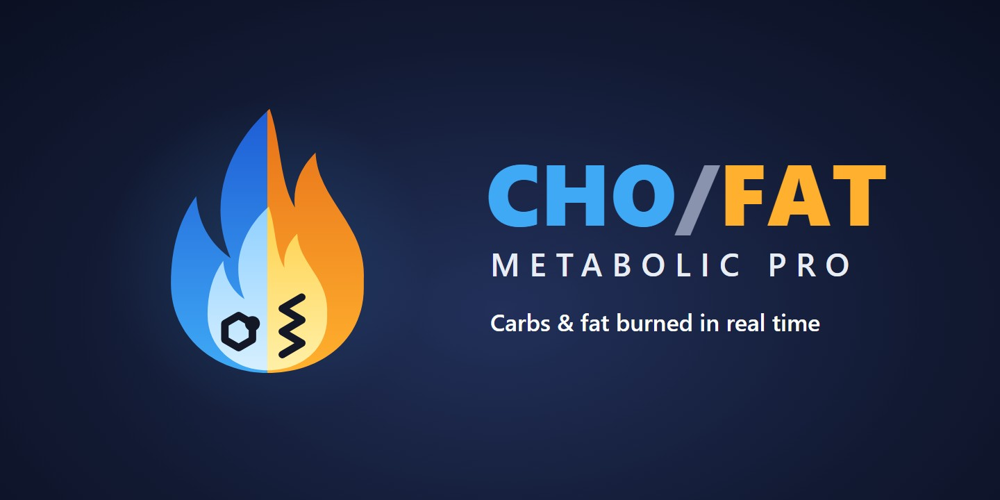

# CHO/FAT Metabolic Pro { .titol-ocult }

{ .capcalera }

Technical documentation for the **CHO/FAT Metabolic Pro** data field for Garmin Connect
IQ: it estimates carbohydrate and fat oxidation in real time during exercise, using only
your watch or Edge — no power meter, no extra account, no payment.

👉 **[Get it on the Connect IQ Store](https://apps.garmin.com/es-ES/apps/d1d623e2-36e9-42c9-a673-fb37d8e8830e)**

## How it works, in two lines

- **How much energy** you burn: **Garmin's own estimate**, the same calories you see in
  Garmin Connect.
- **Where it comes from**: the field splits that energy between carbohydrate and fat
  with a continuous model based on your heart rate and your thresholds, built on
  published exercise-physiology equations. The grams always add up to exactly
  Garmin's calories.

Nothing to set up if your Garmin profile and HR zones are up to date. For who the model
is calibrated for, and how to read the numbers, see the [user guide](03-user-guide.md).

## What's new in 1.0

- The energy now comes from Garmin (`Activity.Info.calories`). Up to version 0.5 the app
  estimated it from heart rate alone, and it tended to come out higher than Garmin's.
- The grams always add up to exactly Garmin's energy.
- If Garmin gives no energy, the field falls back automatically to the previous HR-only
  model.
- The screen, the settings and the fields saved in Garmin Connect do not change.

## Documentation

- **[User guide](03-user-guide.md)** — a plain-language explanation of what the
  data field shows and how to configure it. Start here if you just want to use
  the app.
- **Theoretical basis**
    - **[HR + Garmin energy (1.0)](04-theoretical-basis-garmin-energy.md)** — the model
      used from version 1.0: Garmin's energy split with the RER estimated from HR.
    - **[HR model (up to 0.5)](01-theoretical-basis.md)** — the original model, which
      estimates everything from HR. Version 1.0 still uses it for the RER and as a
      fallback.
- **[How the app works](02-app-implementation.md)** — how the data field is
  implemented: profile, calculation cycle, fallback mode, screen, color coding,
  deployment to the watch.

## Papers

| Model | English | Català |
|---|---|---|
| Estimating carbohydrate and fat oxidation from heart rate and Garmin's energy estimate (1.0) | [PDF](paper/model-fc-energia.en.pdf) | [PDF](paper/model-fc-energia.ca.pdf) |
| Estimating carbohydrate and fat oxidation from heart rate (up to 0.5) | [PDF](paper/model-fc.en.pdf) | [PDF](paper/model-fc.ca.pdf) |

© 2026 Jordi Irazuzta. The papers and this documentation are licensed under
[CC BY 4.0](https://creativecommons.org/licenses/by/4.0/): you may share and adapt them,
as long as you give appropriate credit.
